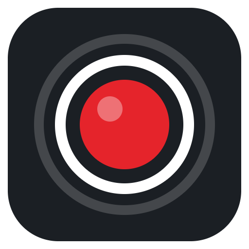
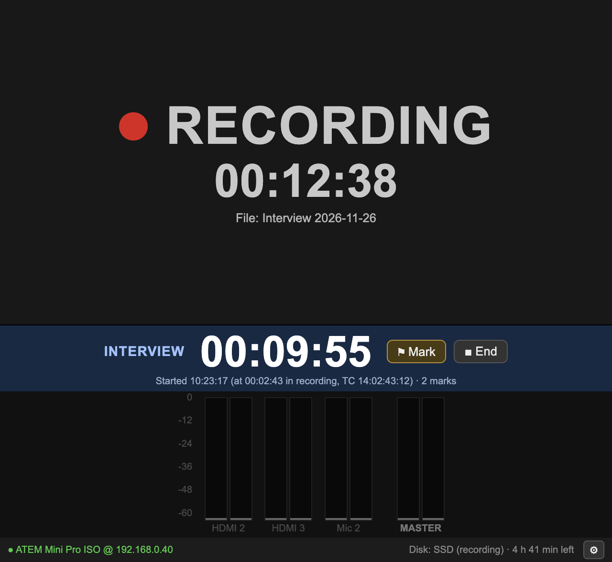
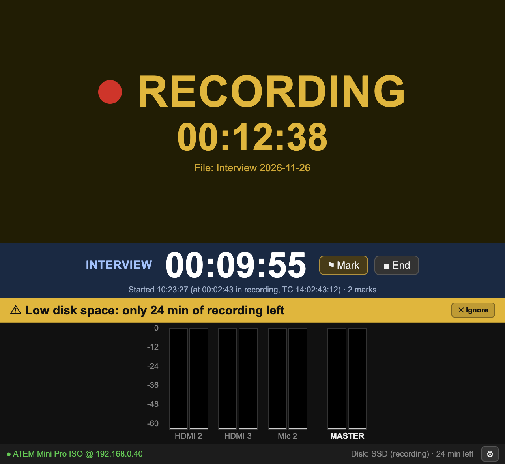
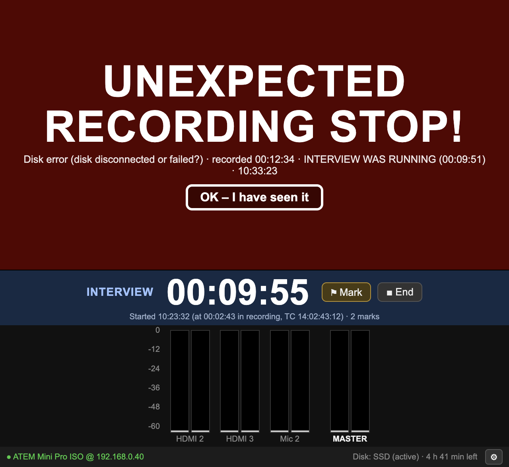
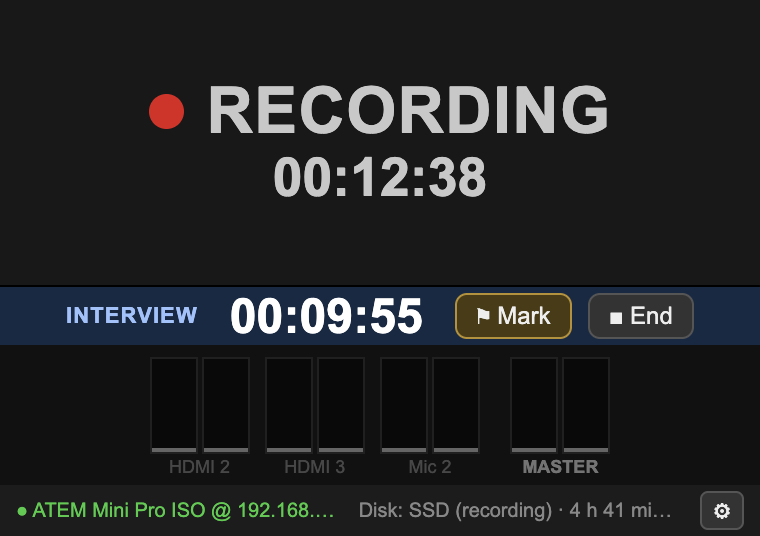

<p align="center">
  
</p>

<h1 align="center">Recording Monitor for ATEM</h1>

<p align="center">
  <b>Never lose an interview again because your ATEM silently stopped recording.</b><br>
  A small desktop app that watches a Blackmagic ATEM Mini Pro / ISO switcher over the network,<br>
  shows the recording status in big letters and alerts you, on screen and in your headphones, the moment recording stops.
</p>

<p align="center">
  
  
  
</p>

<p align="center">
  
  
  
</p>

---

## Why

The ATEM Mini Pro ISO stopped recording in the middle of an interview. Nobody noticed, and the whole session
had to be recorded again. The ATEM's own indicators are easy to miss when you are focused on your guest.
This app sits in a corner of your monitor and makes a stopped recording **impossible to miss**.

## Features

- 🟢 **Big recording status** with recording time: *green* recording · *yellow* recording with a warning · *grey* not recording
- 🔴 **Alarm when recording stops**: flashing red screen, sounds in your headphones, window jumps to the front.
  Stops with an ATEM error (disk full, disk error, disk removed, dropping frames…) or a lost connection are marked
  **UNEXPECTED** and the siren repeats until you acknowledge it
- 🟡 **Early warnings**: low disk space, no / unformatted disk, ATEM error flags, no audio on MASTER, not connected
- ⏱️ **Interview timer**: measures the real interview length, separate from the recording (which usually starts earlier and ends later)
- ⚑ **Marks**: note moments to cut later, with the position in the recording file and the **ATEM timecode**
- 📝 **Session files**: one text file per recording with all events and timecodes, ready for editing in DaVinci Resolve
- 🖱️ **Cursor check**: warns when your mouse cursor is outside the app during an interview (so it isn't visible over your cameras or shared screen in the recording)
- 🎚️ **Audio meters** for all active ATEM audio channels and MASTER
- 🧾 **Event log**: the ATEM has no accessible crash log, so the app writes its own, which helps you find out *why* a recording stopped
- 🪶 **Lightweight**: about 12 % of one CPU core with meters on, under 1 % with meters off

## Requirements

- Blackmagic **ATEM Mini Pro**, **ATEM Mini Pro ISO** (tested) or another ATEM model with recording to USB disk
- The ATEM connected to your network by **Ethernet** (same network as the computer)
- **Windows 10/11** (64-bit) or **macOS**

## Updating
Open **⚙** and click **Check for updates**. If a newer version exists, click the link to open the
[Releases](../../releases) page, download the new `.exe` and replace the old one. Settings, logs and session files
are kept, because they are stored separately from the program.

## Installation

### Windows
1. Download `Recording-Monitor-for-ATEM-<version>-portable.exe` from the [**Releases**](../../releases) page.
2. Run it. No installation needed; it's a single portable file.
3. The app is not code-signed, so Windows SmartScreen may warn you the first time: click **More info → Run anyway**.
4. If Windows Firewall asks, allow access on **private networks** (the ATEM uses UDP port 9910).

### macOS
Build and run from source (see [Development](#development)).

## User manual

### First start
1. Find your ATEM's IP address (ATEM Setup → *Configure* → *Network*).
2. Click **⚙** (bottom right) and enter the IP address. It is saved for next time.
3. The bottom line shows **● ATEM Mini Pro ISO @ 192.168.x.x** in green when connected.
4. Click **⚙ → Test alerts ▾** to hear all sounds once and set the volume.

Place the window wherever you like, for example on your monitoring screen. It can be made very small; everything scales.


The position is remembered **separately for each monitor setup** (e.g. 1 and 2 monitors) and restored automatically
when a monitor appears or disappears.

### The status panel

| Display | Meaning |
|---|---|
| grey **NOT RECORDING** | ATEM is connected and ready |
| green **● RECORDING 00:12:34** | recording, everything OK |
| yellow **● RECORDING** + yellow bar | recording, but check the warning |
| flashing red **RECORDING STOPPED** | recording stopped; click **OK – I have seen it** |
| flashing red **UNEXPECTED RECORDING STOP!** | the ATEM reported an error when it stopped; the reason is shown |
| flashing red **LOST CONNECTION TO ATEM** | the network connection dropped while recording |
| dark yellow **NO CONNECTION** | the app can't reach the ATEM; it keeps retrying |

### Ignoring a yellow warning
If you already know about a warning (for example *no audio* because no microphone is connected), click
**✕ Ignore** on it: the status turns green again and a small grey line per ignored warning shows what is being
ignored and when it comes back. Ignoring and returning warnings are also written to the session file.
Ignoring is always **temporary**. The warning comes back:
- when it **gets worse** (low disk space warns again below 15, 10 and 5 minutes left),
- after **10 minutes** at the latest (`warnIgnoreMinutes` in `settings.json`),
- when the problem goes away and later happens again,
- with the next recording.

Red alarms and *not connected* can't be ignored.

> **Why does every stop raise an alarm?** The ATEM doesn't report *who* stopped the recording. So every stop
> is announced, and you simply click **OK** after you stopped it yourself. If the ATEM reports an error, the stop is
> marked **UNEXPECTED**.

### Sounds

| Event | Sound |
|---|---|
| Recording started | 3 short high beeps |
| Recording stopped | 3 long low beeps |
| Unexpected stop (ATEM error) | 3 long beeps + siren, repeating every 6 s until **OK** |
| Lost connection while recording | siren, repeating until **OK** |
| Connection back, still recording | 3 rising beeps |
| New yellow warning | 2 short beeps |
| Interview start / end / mark | 2 rising tones / 2 falling tones / short blip |
| Cursor outside window (optional) | one soft low tone |

Sounds play on the computer's default audio output.

### Interview timer
The recording usually starts before the interview and ends after it. The blue **interview bar** measures the interview itself:

1. Start recording on the ATEM. **▶ START INTERVIEW** becomes active (it is greyed out while not recording).
2. Click **▶ START INTERVIEW** when the interview really begins.
3. Click **⚑ Mark** to note a moment, e.g. something you may want to cut later.
4. Click **■ End** when the interview is over. The bar shows the final **INTERVIEW LENGTH**.

- **↺ Resume** undoes an accidental *End* (the interview continues).
- Interview time only counts **while recording**. If the recording stops, a running interview ends with it.
- After an interrupted recording, start recording again and click the small **↺ Resume previous** to continue the
  interview timer where it stopped (the pause is not counted). It is offered for 60 minutes.
- The timer survives an app restart.

### Cursor check
During an interview, a flashing orange banner **🖱 CURSOR OUTSIDE THIS WINDOW** appears if the mouse has been outside
the app for more than 3 seconds, so it can't end up visible over your cameras or shared screen in the recording.
Switch it off, or add a soft beep, in **⚙** (*Cursor check*, *Cursor beep*).

### Session files: timecodes for editing
For every recording the app writes a small text file (**⚙ → Open session files**):

```
10:24:12   00:00:00   10:23:52:02  RECORDING STARTED
10:24:27   00:00:14   10:24:06:58  INTERVIEW START
10:24:36   00:00:23   10:24:16:27  MARK 1   (interview time 00:00:09)
10:24:43   00:00:30   10:24:22:50  INTERVIEW END   length 00:00:15, 1 mark(s)
10:24:48   00:00:36   10:24:28:15  RECORDING STOPPED (no error reported by ATEM, recorded 00:00:36)
```

Columns: computer time · position in the recording file · **ATEM timecode** (the same timecode the ATEM writes into
the recorded files, so it matches the timeline in DaVinci Resolve) · event.
A `~` before the position means it is approximate (the app was started while the ATEM was already recording).

### Settings (⚙)

| Setting | |
|---|---|
| **IP** | ATEM IP address |
| **On top** | keep the window above other windows |
| **Audio meters** | off = lowest CPU use (also disables the "no audio" warning) |
| **Cursor check / Cursor beep** | see [Cursor check](#cursor-check) |
| **🔊 volume** | volume of the alert sounds |
| **Test alerts ▾** | play/show every alert without touching the ATEM |
| **Open logs / Open session files** | open the folders |
| **About line** | version, license, **GitHub ↗** link and **Check for updates** (asks GitHub for the latest release, only when you click it) |

Advanced options are in `settings.json` (in the folder above `logs`):
`lowDiskWarnMinutes` (30), `warnIgnoreMinutes` (10), `silenceWarnSeconds` (20), `silenceThresholdDb` (-50), `cursorGraceSeconds` (3),
`logRetentionDays` (90), `sessionRetentionDays` (365; 0 = keep forever).

### Logs and files
| | Windows | macOS |
|---|---|---|
| Logs | `%APPDATA%\Recording Monitor for ATEM\logs\` | `~/Library/Application Support/Recording Monitor for ATEM/logs/` |
| Session files | `…\logs\sessions\` | `…/logs/sessions/` |
| Settings | `%APPDATA%\Recording Monitor for ATEM\settings.json` | `~/Library/Application Support/Recording Monitor for ATEM/settings.json` |

The daily log records every connection change, every recording state change with the raw ATEM error code and disk
status, alarms, and a heartbeat every minute while recording. Old files are deleted automatically: logs after
90 days, session files after 1 year. Only files the app created are touched.

## Troubleshooting

| Problem | What to check |
|---|---|
| **NO CONNECTION** | ATEM connected by Ethernet? Correct IP in ⚙? Computer on the same network? Firewall allows the app on private networks? |
| No sound | Volume slider in ⚙, the computer's output device and volume. Try **Test alerts ▾** |
| Window not visible | Start the app again: it brings the existing window to the front |
| A recording stopped and you want to know why | **⚙ → Open logs**, look at the lines around the stop (`REC`, `ALARM`, `WARN`, `CONN`) |
| "No audio on MASTER" warning | Nobody is speaking or the MASTER fader is down. Raise `silenceWarnSeconds` or switch meters off if not needed |

## Reliability and security

- **Close protection**: while recording or during an interview, closing the app asks *Keep watching / Quit anyway*
- **Crash recovery**: the display reloads itself if it crashes or hangs; errors are logged
- **Single instance**: starting the app again just brings the existing window to the front
- **Clock corrections** (time sync) don't make the timers jump
- **No internet access**: the app only talks to the ATEM on your local network (UDP 9910). No telemetry.
  The only exception is **Check for updates**, which contacts GitHub when you click it
- **Hardened window**: sandboxed, no navigation, no popups, no permissions
- **Dependencies pinned** to exact versions with checksums; package install scripts are disabled

## Development

Requires [Node.js](https://nodejs.org/) (LTS).

```bash
npm ci             # install the exact pinned dependency versions
npm start          # run the app
npm run probe      # print the raw ATEM recording state and audio levels in the terminal
npm run dist:win   # build the Windows portable .exe into dist/
```

### Project structure
| Path | |
|---|---|
| `main.js` | ATEM connection, alert logic, interview timer, logging, window handling |
| `preload.js` | safe bridge between the window and the main process |
| `renderer/` | user interface (`index.html`, `app.js`, `style.css`) and generated sounds (`sounds.js`) |
| `tools/probe.js` | command-line diagnostic |
| `tools/make-icon.js` | renders `build/icon.svg` to `build/icon.png` |
| `docs/` | screenshots |

### Maintenance
Dependencies are pinned, so security fixes don't arrive automatically. Every few months:
```bash
npm outdated                    # see what's new
npm install electron@<version>  # update deliberately, one package at a time
npm audit --omit=dev            # check for known vulnerabilities
npm start                       # test: short recording, interview timer, alarms
```
After an **ATEM firmware update**, always make a short test recording with the app running.

## Credits

- [atem-connection](https://github.com/Sofie-Automation/sofie-atem-connection) (MIT), the library that talks to the ATEM, from the Sofie project
- [Electron](https://www.electronjs.org/) (MIT) and [electron-builder](https://www.electron.build/) (MIT)

## License

© FEDEVEL

This project is licensed under the
[**Creative Commons Attribution-NonCommercial-ShareAlike 4.0 International**](https://creativecommons.org/licenses/by-nc-sa/4.0/) license (CC BY-NC-SA 4.0).
You may use, share and adapt it **for non-commercial purposes**, as long as you **give credit to FEDEVEL with a link
to this project** and share your changes **under the same license**. See [LICENSE](LICENSE).

Third-party libraries keep their own (MIT) licenses.

## Disclaimer

ATEM and Blackmagic Design are trademarks of Blackmagic Design Pty. Ltd. This project is not affiliated with,
endorsed by or supported by Blackmagic Design.
The software is provided "as is", without warranty of any kind. It helps you notice problems, but it cannot
guarantee that a recording succeeds. Always check your recordings.
